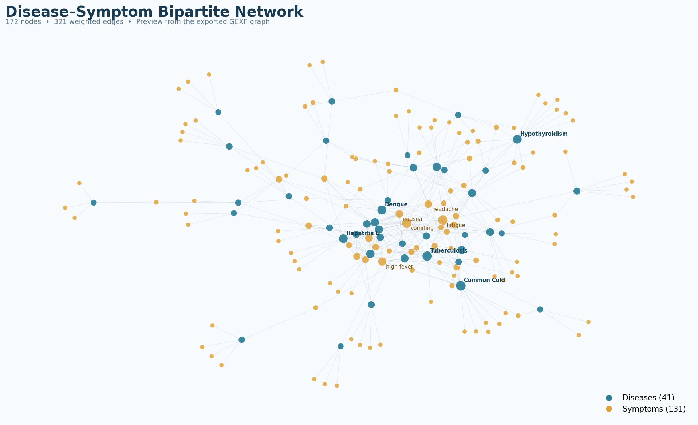

# Disease–Symptom Network Analysis

**Healthcare network science | Graph analytics | Community detection | Python & Gephi**

A university course project exploring relationships between diseases and symptoms through weighted graph construction, similarity analysis, network centrality, and community detection. The work uses a disease–symptom dataset to build a bipartite network and two projected networks, with additional exploratory comparisons of graph clustering methods.



> **Scope:** An educational, exploratory network-analysis project. The networks represent associations in the source dataset, not clinically validated diagnostic relationships. No predictive diagnostic model or real-world clinical deployment is claimed.

## Project overview

The analysis consists of three related graph representations:

1. **Weighted disease–symptom bipartite graph:** Diseases and symptoms are separate node types, with edges indicating observed associations. The implementation combines a normalized co-occurrence frequency with a Cohen's kappa-style association term for edge weights, retaining positive-weight edges.
2. **Disease–disease graph:** Pairs of diseases are linked based on the Jaccard similarity of their symptom sets; Louvain community detection is applied to investigate disease groupings.
3. **Symptom–symptom graphs:** Symptoms are connected using co-occurrence counts and, separately, Jaccard similarity. Centrality measures and Louvain clustering are used to explore key symptoms and symptom communities.

The notebook also explores agreement between **Louvain** and **Node2Vec/DeepWalk-style embeddings + K-Means**, and investigates degree distributions and power-law fits.

## Techniques and tools

- **Graph construction:** NetworkX, weighted bipartite graphs, graph projections
- **Graph metrics:** Degree, weighted degree, betweenness centrality, eigenvector centrality, connected components
- **Similarity:** Jaccard coefficient, co-occurrence counts
- **Community detection:** Louvain algorithm
- **Exploratory validation:** Node2Vec-style embeddings, K-Means, normalized mutual information (NMI), adjusted Rand index (ARI)
- **Visualization:** Matplotlib and Gephi
- **Data wrangling:** pandas, NumPy

## Selected saved results

The graph metrics below come from **outputs already saved in the supplied notebook**, not from a new full end-to-end run. The input row/label counts have also been checked against the included `rawData.csv`.

| Analysis | Saved output |
| --- | ---: |
| Input records | 4,920 (304 distinct complete rows) |
| Unique diseases | 41 |
| Unique symptoms | 131 |
| Weighted disease–symptom network | 172 nodes, 321 edges |
| Disease–disease Jaccard network | 41 nodes, 380 edges |
| Disease communities (Louvain) | 4 |
| Symptom co-occurrence network | 131 nodes, 944 edges |
| Symptom Jaccard network | 131 nodes, 418 edges |
| Symptom communities (Louvain, Jaccard graph) | 18 |
| Node2Vec + K-Means vs. Louvain | NMI = 0.853; ARI = 0.583 |

The included GEXF file was inspected independently and contains **172 nodes and 321 edges** (41 diseases and 131 symptoms).

## Repository structure

```text
disease-symptom-network-analysis/
├── notebooks/
│   └── disease_symptom_network_analysis.ipynb
├── graphs/
│   └── disease_symptom_graph.gexf
├── gephi_projects/
│   ├── disease_disease_louvain.gephi
│   ├── disease_multiple_communities.gephi
│   ├── symptom_symptom_centralities.gephi
│   ├── symptom_symptom_clustering.gephi
│   └── symptom_symptom_louvain.gephi
├── assets/
│   └── disease_symptom_network.png
├── data/
│   └── README.md
├── rawData.csv                     # Dataset used by the notebook
├── requirements.txt
├── .gitignore
└── README.md
```

- **Notebook:** Original Python code and saved outputs are preserved. Persian headings/descriptions were translated into English without changing executable code, variable names, algorithms, or notebook outputs.
- **Dataset:** The supplied `rawData.csv` is included at the repository root without modification. Its 18 columns are `Disease` plus `Symptom_1` through `Symptom_17`.
- **GEXF:** Exported network data; can be opened directly in Gephi and other GEXF-compatible tools.
- **Gephi projects (`.gephi`):** Saved visualization sessions, layouts, and graph explorations. These files are Gephi project files, not GEXF files.
- **Preview image:** A visualization rendered from the provided GEXF network for this README.

## How to run

1. Use a Python environment compatible with the notebook's dependencies (Google Colab is also suitable).
2. Install dependencies:

   ```bash
   pip install -r requirements.txt
   ```

3. The provided dataset is included as `rawData.csv` in the repository root. The notebook calls `pd.read_csv("rawData.csv")`, so run the notebook with the **repository root as the current working directory**; otherwise, copy the CSV into the environment's current working directory (e.g., `/content/` in Google Colab).
4. Open `notebooks/disease_symptom_network_analysis.ipynb` in Jupyter or Google Colab and run the cells sequentially.
5. The notebook writes several `.gexf` exports to its working directory. For pre-existing visualizations, open the included `.gephi` project files in Gephi.

**Dataset availability:** The original `rawData.csv` has now been supplied and is bundled unchanged. Its shape and column names match the notebook input. A clean end-to-end rerun has **not** been performed or verified; results in this README are the saved notebook outputs.

## Limitations

- **Dataset provenance and redistribution license are not verified.** Check the source terms before publishing the CSV in a public GitHub repository. The file contains 4,920 rows but only **304 distinct complete rows** (4,616 duplicates). These rows should not be treated as 4,920 independent, clinically validated patient encounters.
- The inspected CSV schema includes disease labels and symptom fields only; it does not include names or patient IDs. That does not establish that the dataset is clinically representative.
- Graph similarity indicates **overlap of recorded symptoms**, not a validated probability of diagnosis or evidence of clinical causation.
- Community labels and clustering outputs can change with preprocessing, graph weighting, random initialization, software versions, and implementation choices.
- The Node2Vec comparison measures **agreement between exploratory clusterings**, not diagnostic accuracy.
- The implementation is a course project and has not been audited as a clinical decision-support system.

## Academic context and authorship

**Project:** Social Network Analysis in Healthcare (university coursework)  
**Institution:** Amirkabir University of Technology  
**Implemented and documented by:** **Mina Moazzenzadeh**

This repository presents the implementation as an individual university project. The original classroom PDF reports are not included in the public package because they contain personal and administrative information.
